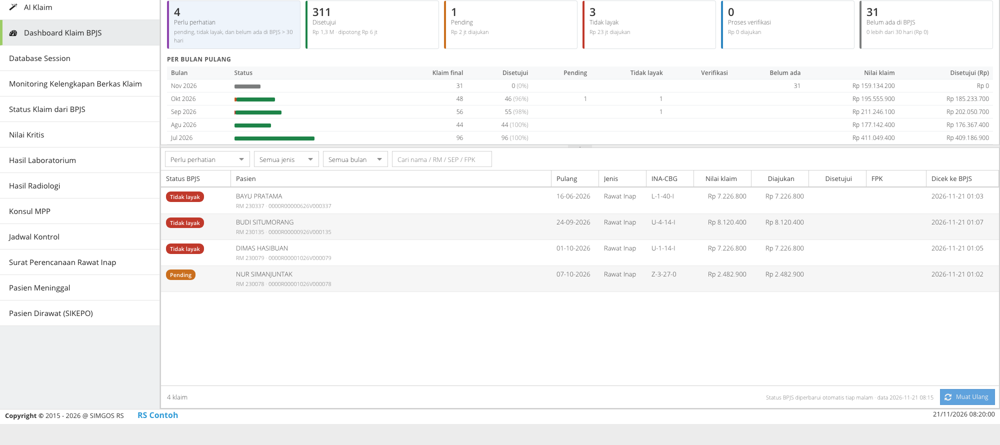

# tatareka-bpjs-monitoring

Update status klaim BPJS di SIMGOS otomatis setiap malam, plus **Dashboard Klaim BPJS** di menu Monitoring.

## Install

    dnf install https://repo.tatareka.com/tatareka-release.rpm
    dnf install tatareka-bpjs-monitoring

User SIMGOS yang punya hak akses **DASHBOARD KLAIM BPJS** akan melihat **Monitoring › Dashboard Klaim BPJS** setelah
login ulang. Saat pertama dipasang, hak akses ini diberikan ke user group **Admin SIMRS** yang bisa membuka Monitoring.

## Usage

    tatareka-bpjs-monitoring status   # aktif atau tidak, hasil run terakhir
    tatareka-bpjs-monitoring plan     # yang akan dicek malam ini
    tatareka-bpjs-monitoring run      # cek sekarang

## Cara kerja

- Setiap malam jam 01.00, SIMGOS mengecek ke BPJS status klaim final 180 hari terakhir yang belum disetujui.
- Jalan di server SIMGOS, bukan di PC petugas.
- Tidak menyimpan credential BPJS: call ke BPJS dilakukan oleh SIMGOS dengan akses rumah sakit.
- Akses database read-only (user `bpjs_mon`).

## Setting

- Matikan cek malam: `refresh = off` di `/etc/tatareka-bpjs-monitoring/monitoring.ini`
- Siapa yang melihat menu: hak akses **DASHBOARD KLAIM BPJS** (modul 909802, di PLUGINS › TATAREKA KLAIM). Centang di
  Manajemen Pengguna untuk group (Group Pengguna Akses Modul), lalu di akses modul tiap user yang perlu, seperti hak akses
  SIMGOS lainnya; berlaku setelah user login ulang. Update paket tidak mengubah siapa yang memegangnya.
- Sembunyikan menu untuk semua user: `"enabled": false` di `aplikasi.properti_config` ID 909902

Apache-2.0 · PT Tatareka Sistem Hidup
